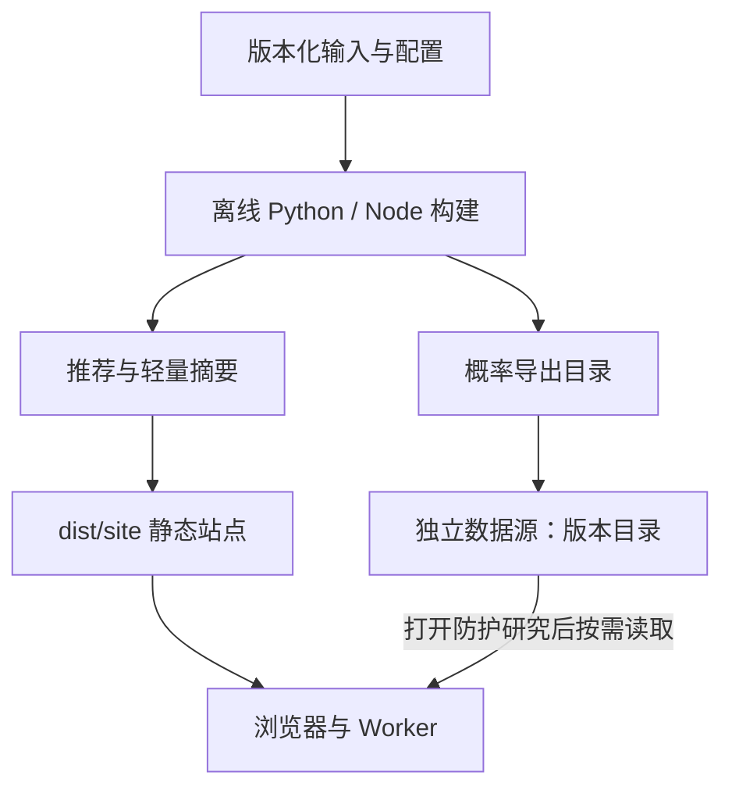

# 架构与维护边界

## 两种发布产物

网站访问路径与离线计算路径分开。发布网站时只读取快照、已计算推荐及少量元数据；不扫描原始游戏客户端、不执行射线计算，也不遍历概率分片目录。

`web/` 是源码目录，不能作为生产托管根目录。`dist/site/` 是生成目录，可以完整替换，不手工维护其中的文件。默认构建不包含 `data/exports/probability/` 的索引或二进制数据；`external` 模式仅在站点清单中写入外部索引 URL 与可用的哈希。

## 模块的责任

| 模块 | 负责 | 依赖方向 |
|---|---|---|
| `backend/wt_atlas/` | 采集、版本对齐、几何/材料、计算、导出 | 固定来源、模型配置与参考实现 |
| `shared/engine.mjs` | 纯决策逻辑、场景应用与瞄准积分 | 数据和模型参数；无网络 |
| `shared/probability-codec.mjs` | 纯概率二进制解码，Float64 与未知语义 | 索引编码契约；无网络 |
| `scripts/build_probability_summaries.mjs` | 逐分片离线积分、构建轻量摘要 | shared 引擎与解码器 |
| `scripts/build_decisions.mjs` | 国家/版本推荐预计算 | snapshots、shared 引擎 |
| `scripts/decision_bundle.py` | 将离线研究摘要投影为浏览器配对输入，保留原始身份与统计 | 原快照与引擎配对契约 |
| `scripts/build_web.py` | 校验输入身份、组装站点、切换发布目录 | 标准库与 `site_lib.py` |
| `scripts/site_lib.py` | 发布路径、文件边界、来源复制、体积预算 | Python 标准库 |
| `web/data-client.mjs` | HTTP、gzip、完整性、有界 JSON 缓存 | 纯解码器；不负责物理算法 |
| `web/worker.mjs` | 按视角载入计算数据并执行共享引擎 | 数据客户端、shared 引擎 |
| `web/app.mjs` | 页面状态、呈现、用户操作 | 客户端与 Worker |

`shared/` 是唯一源码。浏览器源码使用 `../shared/` 导入；组装时复制到 `dist/site/shared/`，并把站点模块中的导入改为 `./shared/`。没有手工同步的 `web/shared/engine.mjs` 副本。解码器与传输层分开，修改重试或缓存逻辑不再改变物理摘要的解码来源哈希。

## 数据生命周期

1. **来源与工作缓存**：`data/raw/`、`data/cache/`、`data/work/`。保留出处与版本；不进入静态发布。
2. **输入快照**：`data/snapshots/`。供计算和网站构建使用，不因本地 UI 修改而改变。
3. **派生推荐**：`data/derived/recommendations/`。缓存身份包含目录、方案、模型、目标层、概率摘要和共享引擎哈希。组装器拒绝过期或缺国别/版本的结果。
4. **大型概率导出**：`data/exports/probability/`。每个分片有 SHA-256 内容地址，索引引用具体物理身份。导出重用已验证 gzip；不会自动删除历史内容。
5. **站点产物**：`dist/site/`。只复制本次清单引用的推荐文件和轻量资料；目录替换清除旧站点中的废弃文件，不影响计算缓存和远端旧版本。
6. **远端版本目录**：`probability/<index_sha256>/`。分片先于索引上传。旧站点继续引用旧版本，回滚时恢复站点产物即可。

CPU 结果 NPZ 原子写入。发布 staging 优先使用校验后的硬链接，跨文件系统时原子复制，减少计算结果重复占用磁盘；CUDA 可变输出保留安全复制。全量计算并发和单份 NPZ 尺寸仍影响峰值内存，不能因为站点变轻就假定计算端无需大磁盘。

## 浏览器资源边界

首屏不请求参考热图索引。进入防护研究后读取索引，再请求当前目标、弹药和角度的二进制切片；离开研究页或改变角度会取消旧请求。外部数据失败时显示可重试状态，推荐和图鉴仍可用。

默认 JSON 传输缓存最多 32 项、16 MiB 的解压后源字节；Worker 缓存最多 4 项、32 MiB。缓存身份包含 URL、长度与哈希，失败请求不永久保留。这个预算不是浏览器总堆内存上限：解析对象、页面状态、索引和当前 Float64 热图仍会占用额外内存。大于缓存预算的 JSON 可以读取但不会留在传输缓存中。

完整离线积分摘要不会原样发布给 Worker。站点只保留 `reference_only` 严格等于 false 的记录及其完整字段，保留原模型、来源哈希和省略数量；每个目标仅保存一条存在信息，以维持“有参考图但无精确配对”的原解释。研究数据和完整来源留在原快照，投影前后的配对、队列和推荐用同一引擎验证一致。概率上传清单也只公开版本与总量，不把全部对象列表塞回站点。

完整索引当前仍按需一次加载。若未来车辆、弹药维度继续增长，应在保持物理身份和解码格式不变的前提下，进一步拆分为目标目录与逐目标元数据；这次重构没有把所有 10+GB 数据转换成另一份巨型浏览器对象。

## 构建与发布的失败行为

网站在目标目录旁的临时目录中组装，验证引用与预算后才替换现有目录；失败保留旧站点。只替换带 `.wt-atlas-site` 标记的生成目录或空目录，拒绝覆盖源码、工作数据或未知目录。目录替换是构建机上的发布步骤，托管端仍应使用自己的完整版本上传/切换机制。

站点 ZIP 仅枚举生成目录，拒绝后端脚本、GRP/NPZ、隐藏配置与符号链接；逐文件 SHA-256 和 ZIP CRC 可独立检查。它不再打包整个源码工作区，也不把旧的浏览器报告当作本次代码已验收的证明。
