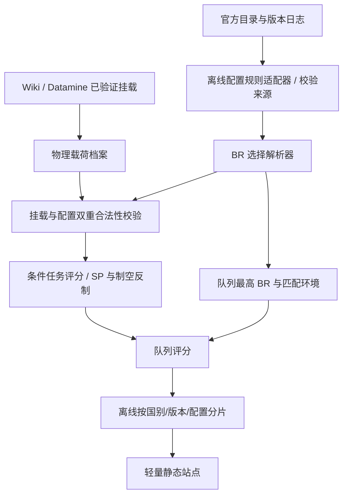

# 按武器配置选择战斗权重：架构预备方案（2026-10-30）

状态：**基础解析与安全门禁已接入；生产配置数据、UI 选择器与自动组合搜索尚未接入**。

官方依据：[2026-10-29 开发日志](https://warthunder.com/en/news/10294-development-custom-battle-rating-for-aircraft-more-freedom-for-your-vehicles-en)。日志宣布计划在下一次大型更新对**部分飞机和直升机**引入自选 BR 配置，并考虑未来扩展至地面载具。文中的 Tiger UHT / MiG-21 Bison 数字均为**暂定示例**；不得录入生产目录。正式型号名单与规则以实际版本更新日志/游戏客户端为准。

## 1. 规范：BR 与评分是两件事

- **官方匹配 BR** 是版本化、模式化、官方声明的离散配置值。不能以导弹数量、最大射程、制导方式或本站评分权重线性推算。
- **本站任务效用评分** 是条件模型输出，同一架飞机选择不同合法挂载时，其对空、对地、任务持续能力、SP 可用性可改变；它不是游戏 BR、胜率或击毁率。
- **改装研究状态** 只决定某配置能否选用；不会自动把当前 BR 升高。即使解锁全部武器也可主动选择低 BR 配置，前提是相应武器受到禁止。
- **实际同时挂载** 必须是游戏/Datamine/Wiki 已核验的完整预设，不可把若干许可单项武器拼成一个未经验证的理想混挂。
- **模式分离**：同一官方配置在 Air RB 和 Ground RB 可以有不同 BR。地面历史模式的队列匹配只使用 Ground RB BR；不得直接搬用开发日志 Air RB 截图数值。

公式（以玩家选定的配置 `c`、合法挂载 `l`、战局情景 `z` 表示）：

```text
official_br = BR(vehicle_id, selected_rating_configuration_id, mode, game_version)
allowed    = unlocked(c) AND legal_simultaneous_loadout(l) AND permitted(c, l)
lineup_br  = MAX(official_br for all lineup members)
utility    = Score(vehicle_id, c, l, opponent, scenario, available_spawn_points)
lineup     = EvaluateLineup(lineup_br, active configurations, match distribution, spawn states)
```

`utility` 不反馈修正 `official_br`；想要预测更合理的 BR 只能另建显式标明为建议值的分析功能。

## 2. 数据契约（当前只支持具有官方核验来源的 profile）

`rating_configurations` 是可选字段；缺失时继续读旧 `vehicle.br.current/planned`。完整样例**仅为合成测试结构，不代表真实游戏载具或已公布 BR**：

```json
{
  "id": "fixture_aircraft",
  "kind": "aircraft",
  "br": { "current": 10.0, "planned": 10.0 },
  "rating_configurations": {
    "ground_rb": {
      "status": "official_verified",
      "source": {
        "url": "https://example.invalid/official-version-reference",
        "game_version": "fixture",
        "snapshot_sha256": "fixture"
      },
      "options": [
        {
          "id": "basic",
          "br": { "current": 10.0 },
          "required_modification_ids": [],
          "allowed_loadout_ids": ["fixture_basic"]
        },
        {
          "id": "advanced",
          "br": { "current": 11.0 },
          "required_modification_ids": ["fixture_researched_mod"],
          "allowed_loadout_ids": ["fixture_basic", "fixture_advanced"],
          "allowed_weapon_ids": ["fixture_basic_weapon", "fixture_advanced_weapon"]
        }
      ]
    },
    "air_rb": {
      "status": "official_verified",
      "source": { "url": "https://example.invalid/air-mode-reference" },
      "options": [
        {
          "id": "air_basic",
          "br": { "current": 12.0 },
          "required_modification_ids": [],
          "allowed_loadout_ids": ["fixture_basic"]
        }
      ]
    }
  }
}
```

规范字段：

| 字段 | 规则 |
|---|---|
| `rating_configurations[mode].status` | 只有 `official_verified` 才参与正式 BR 解析 |
| `source.url` | 必须有原始数据依据；将来采集应同时记录游戏版本和内容哈希 |
| `options[].id` | 同车、同模式内稳定唯一；不能根据排序索引作 ID |
| `options[].br.current/planned` | 直接采集的官方值或同规则明确继承；不能公式猜测 |
| `required_modification_ids` | 解锁该配置所需改装；未知与空数组不同 |
| `allowed_loadout_ids` | 该配置允许的已核验完整预设 ID |
| `allowed_weapon_ids` | 可选、进一步限制预设里的具体弹药；若两组列表都有，必须同时满足 |
| `vehicle.loadouts` | 仍由原有物理挂点、冲突、重量和预设合法性管线负责 |
| `vehicle.configuration_id` | 保留几何/材料物理身份；不得当成 BR 选项 ID 覆盖 |

配置允许携带哪些武器**不是**“所有已研发武器取最大威力”。默认拒绝未知许可的预设；仅有排除列表也不足以证明其它挂载都合法。

## 3. 数据流与代码



本次新增 `shared/rating-configurations.mjs`，并接入 `shared/engine.mjs`：

- `resolveRatingConfiguration(vehicle,{mode,version,configuration_id,...})`：严格返回 BR、状态、报错与未核验原因。
- `resolveVehicleRating(vehicle,context)`：适配引擎已有 `context`；从用户选择读取 `configuration_by_vehicle`。
- `validateRatingLoadout(vehicle,loadout,context)`：在原 `validateLoadout` 的物理合法性之外，检查当前档位的预设/武器许可。
- `enumerateRatingConfigurations(vehicle,options)`：供未来 beam search 生成候选；它**只枚举，不替用户选择**。
- `getBR(vehicle,version,context)` / `matchEnvironment(...,context)` / `evaluateLineup(...)`：按显式选择重算队列 BR 与合法配对。原二参数 `getBR` 对旧目录保持兼容。

前端/Worker 的未来请求示意：

```json
{
  "version": "current",
  "mode": "ground_rb",
  "configuration_by_vehicle": {"fixture_aircraft": "basic"},
  "loadout_by_vehicle": {"fixture_aircraft": "fixture_basic"},
  "unlocked_modifications_by_vehicle": {"fixture_aircraft": ["fixture_researched_mod"]},
  "require_unlocked_modifications": true
}
```

这四个概念必须独立存储：

1. 载具拥有与否（`availableIds`）。
2. 改装是否研发（`unlocked_modifications_by_vehicle`）。
3. 挂在车库里的官方 BR 选项（`configuration_by_vehicle`）。
4. 战局预期使用的合法弹药预设（`loadout_by_vehicle`）。

没有合法解锁状态的玩家专属推荐需要 `require_unlocked_modifications:true`；未知时拒绝，而非假设满改。若只是理论研究、未请求自己拥有的车库，可允许解锁状态未知，必须标为假设。

## 4. 对现有队列引擎的影响

`lineup_br=max(BR_i)` 改为对**玩家选定的配置**求最大，而不是一律取 `vehicle.br` 的最高/最低值。

以下问题在没有官方数据时不能由当前引擎猜测：

- 对手会以何种配置进入战场；不能把一个多 BR 载具简单当作多个“独立敌车”而增加其出现概率。
- 配置不同导致的实际空空导弹能力、制导能力、对地毁伤与 SP 花费；需要使用该配置允许的**合法完整挂载**重新评价。
- 一国全 BR 自动优化时，需要枚举 `(vehicle_id,rating_configuration_id,loadout_id)` 候选，约束同一物理载具不能重复占用槽位，也不能跨 BR 复用同一个假定组合。

在这三个问题未验证之前，运行时的安全行为是：

- 对具有多 BR 数据但未选择档位的己方车辆：`getBR=null`，该队列判无效；
- 有可能进入当前 BR 窗口但未选择档位的敌车：明确报告 `opponent_rating_configuration_unresolved`，不能悄悄把它排除后给高分；
- 自动推荐只针对已显式选择的配置工作，结果标记 `automatic_configuration_search:false`，`all_effective_caps_scanned:false`（有未选配置时）；
- 旧 `applyScenario` 的单个 `br` 调整不准写入多 BR 载具，返回 `configuration_specific_br_change_required`。未来调整源需要增加 `vehicle_id + mode + configuration_id + version` 的复合键。

这套基础设施**不等于未来机制已经可用于生产排行**。尤其在没有完整“敌车配置分布”或用户未声明配置时，不应显示夸大的队列分数。

## 5. 缓存、版本与静态托管

以三层身份避免不必要的 10+GB 重算：

1. **物理层**：GRP/材料、目标构型、弹药实际 profile 哈希、射距/角度、瞄准上下文。仅修改 BR 不失效。
2. **规则与条件层**：游戏版本、游戏模式、`vehicle_id`、`rating_configuration_id`、`loadout_id`、挂载/改装许可哈希、模型参数、SP 规则版本。
3. **决策层**：队列成员及各自配置、场景分布、对手配置先验、候选搜索版本、算法版本、输入快照哈希。

项目现有推荐构建的 `catalog_sha256`、`engine_sha256` 和模型配置哈希已经能够让**目录变化**触发离线推荐重算。未来把社区和配置规则拆成独立文件后，要把它们自己的哈希显式纳入构建键。前端只发布小型规则目录和按需载入的配置/任务摘要；原概率分片继续独立对象存储，不因 BR 配置而重复发布。

## 6. 后续正式上线门槛

- 正式名单、同模式每档 BR、所属改装、禁止武器与完整预设由当前官方补丁/客户端核验；开发日志示例不入库。
- 把 `backend/wt_atlas/sources.py` / `loadouts.py` 扩展为带来源、提交与身份指纹的配置适配器；对齐 Wiki 和 Datamine 版本。
- 前端增加“车库配置档位”和“合法挂载”联动；选择改变后同步更新该队列最高 BR、可匹配对手、CAS/CAP/SP 及 V2 评分，不触发 GRP 物理重算。
- 扩展自动候选搜索：按载具父 ID 防重复，并按载具父 ID → 配置的条件概率进行对手先验分配；没有实测比例可给出可变先验及区间，不能冒充真实频率。
- `compareVersions` 新增同载具 profile 的逐版映射与“低 BR 档消失/武器移除”的迁移提醒；不能把版本变更造成的配置调整解释为车辆不再可用。
- 给定不同配置的同一架战斗机，独立测试对空任务和 CAS 条件评分；没有空空模型的场合，相关评分应明确未知。

回归：`node --test tests/rating-configurations.test.mjs`。合成测试只验证协议与反例，不使用开发日志的暂定 BR 作为生产数据。
