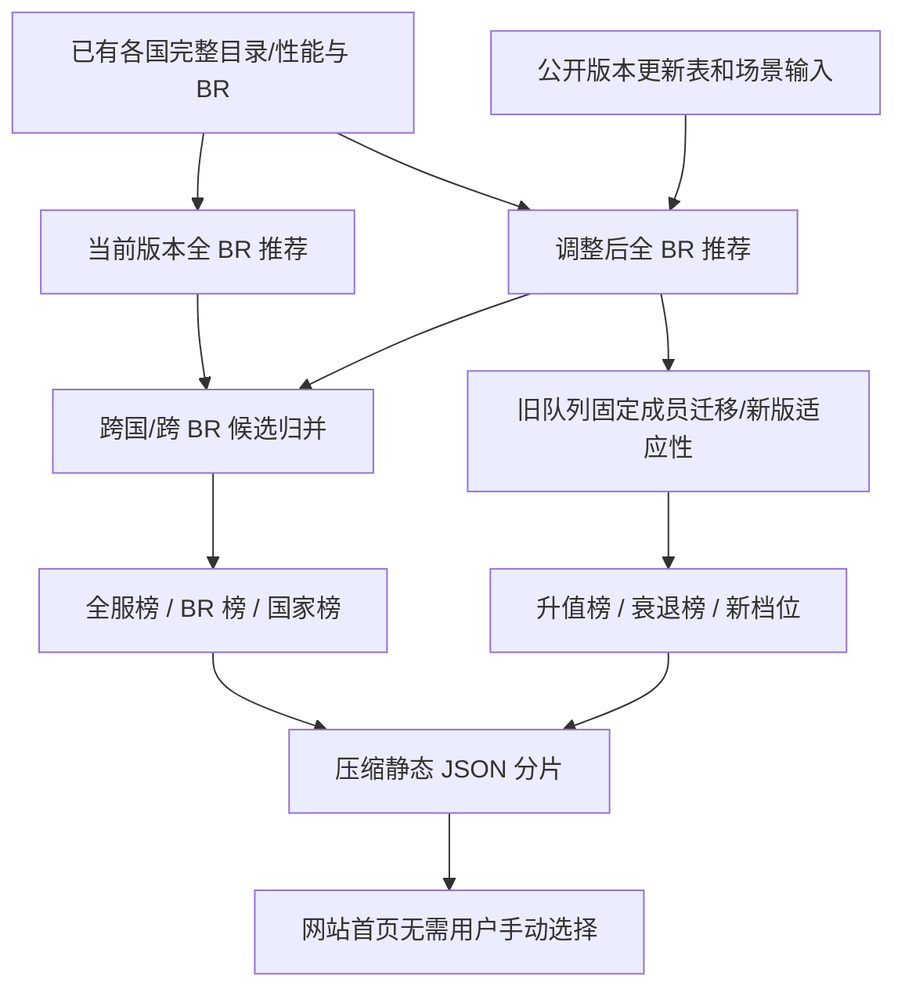

# Next Patch Meta Predictor：版本前瞻自动队列推荐（架构与实施方案）

## 产品定位

**不是玩家提交队列后打分。** 核心是系统主动扫描**各国家 × 各陆战历史 BR × 全部合法载具/配置**，自动发现新版本的优质地面历史队列，并公开：

- 下版本全服候选 Top 100、每个 BR 的最优国家/队列、每国不同 BR 的最优队列。
- 固定旧队列带入新版后的升值/衰弱；新版重新配队的可恢复空间；新出现的 BR 档位。
- 新武器、BR、敌方环境、可用制空和防空能力分别造成的影响。
- 数据版本/公告状态/模型校准状态/缺失数据，使预测与事实区别明确。

当前仓库已有 `recommendNation()`、`buildVersionOverview()` 和离线每国 `current/planned` 分片。**现有推荐搜索不是全组合最优：每个 BR 从一个地面 anchor 和三种预设角色序列做贪心搜索。** 当 2 辆以上载具必须一起换才能提升价值时，会陷入局部最优。因此“全服扫描所有 BR”不等于“全服枚举所有合法队列”。发布时必须暴露 `global_optimum_guaranteed:false`。

## 第一阶段：可实际运行的全服预测榜（本 PR）

新增 `shared/meta-rankings.mjs`，在**离线** `scripts/build_decisions.mjs` 完成全国 current/planned 搜索后合并全部候选，而不是只取每国 `best`。



- 仍使用 `shared/engine.mjs` 的同一套待校准效用函数，避免不同版本用不同公式打分。
- 合并 `candidates + alternatives_at_br`，不再只保留各国一个首推。
- 以国家+载具父 ID+显式 BR 配置+挂载身份作为队列键；同成员顺序变换不算另一队列。
- 多队列结果排序、去重，按国家/BR 做可配置多样性约束，防止 100 支结果全是同一档的近似替换。
- `coverage`、`lower/upper` 保持原值，低资料覆盖和大不确定区间标记为待审查；不把缺失值补零或虚构胜率。
- 通过 `index.impact` 区分：保留相同成员的效用变化 `fixed_lineup_delta`、重新优化的提升空间 `adaptation_gain`。二者都不是实际胜率或名次变化。
- 新入口 `manifest.meta_rankings` 引用不可变哈希文件，站点仅加载小型元数据而不携带 GRP/NPZ。
- `web/app.mjs` 首页展示预测榜，版本页展示升值/衰弱原阵容；旧自定义队列仍留在研究工具区作为辅助而不是产品主入口。

**尚不能称真正全局最优或真实 Meta**：输入仍是旧贪心搜索的候选，实战胜率/国家出现率/玩法偏好没有校准。全球指数是在各自的合法 BR 匹配环境下求出的条件效用，不是不同 BR 车辆互相交战，也不是游戏对全 BR 出场率的经验排名。

## 第二阶段：把贪心搜索升级为真正的跨 BR/挂载组合搜索（后续）

定义原子候选：

```json
{
  "vehicle_id": "source_stable_id",
  "nation": "nation",
  "domain": "ground_or_air",
  "rating_configuration_id": null,
  "loadout_id": null,
  "effective_ground_rb_br": null,
  "source_status": "official_verified_or_unknown"
}
```

在未来官方正式公布按挂载自选 BR 后，必须先通过配置规则解析，枚举 `vehicle_id × official_BR_option × legal_complete_loadout`，不能线性求出虚假 BR。若没有官方档位或武器许可证据，禁止进入生产候选。合成测试只使用虚构身份。

针对目标国家 `n`、BR 上限 `b` 与槽位数 `k`，求：

```text
max  RobustUtility(L | snapshot, matchup, scenario, model)
s.t.
    all vehicles in nation n
    distinct parent vehicle_id and multi_vehicle_system_id
    each configuration and simultaneously mounted loadout are legal
    max(effective_ground_rb_br_i) == b (true cap)
    1 <= |L| <= k
    ground vehicle exists
    air vehicle count / spawn-point availability respects rules
```

**不能只选相对强的单车**。推荐算法应至少经过：

1. **各类候选预筛选**：按具体 BR 和任务产出帕累托候选（火力/机动/防护/占点/防空/制空）；禁止因为类别平均分弱就剪掉有独门功能的防空或侦察车。
2. **多起点 Beam Search**：先选若干地面 anchor，以分支限宽搜索不同地面、制空、防空、CAS 组合；保留多个中间解，避免一次错误的贪心选择锁死整队。
3. **局部改进与二元交换**：替换 1–2 个槽位，并允许飞机配置高档/低档同时变化；重新计算最高 BR 和对手环境。
4. **情景重估**：按下房、平房、上房、地图距离、低空/高空威胁等评估每支 finalist 的期望和最差表现；各情景概率必须标明是先验还是实测。
5. **对手队列联动**：先生成各国对手队列，不能只把敌方单车当独立、等概率出场。在多 BR 飞机出现后，按 `vehicle_id` 归一化再分配到配置概率，避免一架飞机因为有 3 档 BR 而被计算成 3 倍出现率。
6. **多目标筛选**：分别给出“最高条件效用”“抗升房”“低成本（常规研发）”“空地综合”榜；不能把胜率、研究成本、人民币价格混为一个分数。

对于固定可用槽位数应分别预计算不同 `k`（例如 5/8/10）；10 槽不能天然压倒 5 槽。这些数字应当作为公开搜索配置而非隐含的算法常量。

## 版本更新时的核心比较

```text
L_old         = argmax_L S_current(L)
L_old_carried = same physical vehicles under upcoming patch; all BRs reevaluated
L_new         = argmax_L S_upcoming(L)
```

- **环境冲击**：`S_upcoming(L_old_carried)-S_current(L_old)`。双方的版本快照须标注，且只允许在模型相同、数据口径可比较时直接做差。
- **重新组队收益**：`S_upcoming(L_new)-S_upcoming(L_old_carried)`，两边属于同一新版环境。
- **自然崛起**：成员完全未修改，但新敌方匹配或空中威胁范围改变导致队列升值。
- **被迫拆队**：旧队列仍合法，但保留全部成员显著不如调整编成。
- **配置套利**：同一飞机低档 BR 保留大部分有用能力并避免抬升地面队列最高 BR；只有官方已核验的配置允许时才可推荐。

若更新机制仍属 devblog/开发中，应生成单独的“预测情景”分支，显示有效范围和假设，不得以正式版本名称发布虚构游戏数据。

## 评分公平性与社区信息

不以任意国家/BR 的战斗力绝对数值直接宣称跨档“最强坦克”。首页的“全服强势”定义为在**各自 Ground RB 匹配条件、统一模型与固定槽位规则**下表现领先的队列。输出同 BR 排名、升房风险、资料覆盖、区间；跨 BR 总榜默认标明“相对效用预测，未经实战校准”。

社区讨论可用于发现未建模因素（特定地图、炮弹后效、SPAA 干扰、开局占点、队列深度），但不能直接把论坛点赞数或选择性上传的胜率等同为能力值。可以通过时间分层/玩家技能/队列 BR 控制后的样本，独立验证权重；无可用样本时应维持 `uncalibrated`。

## 数据状态

- 2026-10-29 的官方更新 **2.59.0.92** 已实施一轮 BR 调整；如该更新成为当前基线，就不能再把相同数据作为“下版本预测”。
- 2026-10-29 的 **Custom Battle Rating for Aircraft** 仍是下一次大型更新计划；示例飞机和导弹配置、BR 可能更改。地面自选 BR 仅为未来考虑。
- 发布器必须区分 `released`、`announced`、`proposed`、`hypothetical`、`unknown`，且基线与方案来自各自可追溯快照。

官方来源：
- https://warthunder.com/en/game/changelog/
- https://warthunder.com/en/news/10294-development-custom-battle-rating-for-aircraft-more-freedom-for-your-vehicles-en

## 当前实现边界 / 后续实现顺序

本 PR 先交付 **能真正公开浏览的跨国、全 BR、版本变化预测榜**，且不改变原始评分/GRP 物理身份。后续按优先级分别做：

1. 完整版本快照与 `released / proposed` 状态分类，明确来源时间和 game version。
2. Beam/Swap 搜索替换当前贪心，评测每 BR 候选数、模型资源耗费和基准最优小集合误差。
3. 在 `feature/loadout-dependent-br-foundation` 的官方自选 BR 数据契约基础上，增加跨配置候选枚举与合法性校验。
4. 匹配环境从均匀敌方单车先验升级为敌方队列与配置概率分布；不填造经验出场率。
5. 多种槽位、数据可信区间和排行榜重现测试；正式接入社区样本后再启用统计校准。

只修改 BR 不使 GRP 射线缓存失效；更改弹药物理、几何或材料时仍必须按精确来源/构型哈希失效。
